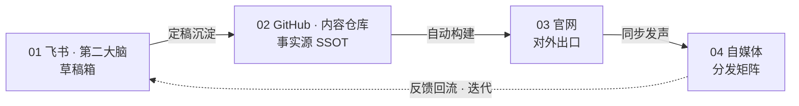

# 信息流转图：

飞书（草稿箱） → GitHub （事实源）→ 官网（发布） → 自媒体（分发）

## 一、流转总览

| 环节 | 角色 | 关键动作 | 产出 |
| --- | --- | --- | --- |
| 01 飞书·第二大脑 | 草稿箱 | 起草、讨论、反复修改 | 一版可交付的宣传册 / 文案 |
| 02 GitHub·内容仓库 | 事实源（SSOT） | PR 提交、评审合并、版本留痕 | 权威版本 + 触发构建 |
| 03 官网 | 对外出口 | 页面自动同步刷新 | 可检索、可引用的正式内容 |
| 04 自媒体 | 分发矩阵 | 公众号 / 视频号 / 小红书同步 | 扩散触达 + 评论反馈 |

## 二、各环节说明

### 01 飞书 · 第二大脑 —— 草稿箱

- **起草**：内容在对应篇章（如「招聘篇」）里写初稿、讨论、反复修改
- **暂存**：未定稿内容只在此沉淀，**不直接对外**
- **输出**：一版可交付的宣传册或文案，等待沉淀进事实源

### 02 GitHub · 内容仓库 —— 事实源（SSOT）

- **定稿入库**：以 PR 提交，评审合并后成为权威版本
- **版本留痕**：谁改的、改了什么、何时改，全程可追溯
- **触发构建**：合并即驱动官网自动更新，不再手工搬运

### 03 官网 —— 对外出口

- **正式生效**：页面同步刷新，对外统一口径
- **权威可引用**：可检索、可引用，作为对外唯一正式版本
- **避免打架**：页面由仓库派生，杜绝新旧版本并存

### 04 自媒体 —— 分发矩阵

- **矩阵分发**：公众号、视频号、小红书等同步发声
- **统一口径**：基于官网版本改写，不做二次创作式走样
- **回收反馈**：收集评论与疑问，作为下一轮起草的输入

## 三、示例：招聘政策变更

1. 招聘政策调整后，先在**飞书「招聘篇」**起草新版宣传册初稿
2. 定稿后提交 **GitHub**，评审合并，正式成为事实源
3. **官网**招聘页由仓库自动构建、同步上线
4. **自媒体矩阵**依据官网版本同步发声，扩大触达
5. 外部疑问与反馈回流到飞书，进入下一轮迭代

