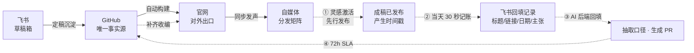

# 信息流转图（双轨版）：飞书 ⇄ GitHub → 官网 → 自媒体

> **飞书是草稿箱，GitHub 是唯一事实源。**
> 事实源可以**滞后**，但不能**丢失** —— 滞后用 72h 回填 SLA 兜底。

---

## 一、为什么是双轨

- **规范流卡住**：要求你在灵感未成形时就交出结构化 brief，让 AI 替你完成"想清楚"这一步 —— 而这一步只能你自己做，所以写不出来。
- **灵感流顺畅**：自媒体是低格式要求的出口，允许边写边想，灵感在里面自然生长。
- **灵感流的代价**：发布即"既成事实" —— 有时间戳、有读者、有外链，唯独没有版本号。事后回填不是整理，是**考古**。

结论：不推翻习惯，缺的是一个把"已发布内容"收编回事实源的**低成本动作**。

---

## 二、轨道 A · 规范流（正向定稿）

适用：**政策、制度、对外承诺**等有明确 brief、口径必须先定的内容。

| 环节 | 角色 | 关键动作 | 产出 |
| --- | --- | --- | --- |
| A1 飞书·第二大脑 | 草稿箱 | 起草、讨论、反复修改 | 一版可交付的宣传册 / 文案 |
| A2 GitHub·内容仓库 | 唯一事实源 SSOT | PR 提交、评审合并、版本留痕 | 权威版本 + 触发构建 |
| A3 官网 | 对外出口 | 页面自动同步刷新 | 可检索、可引用的正式内容 |
| A4 自媒体 | 分发矩阵 | 公众号 / 视频号 / 小红书同步 | 扩散触达 + 评论反馈 |

---

## 三、轨道 B · 灵感流（先行后补）

适用：**观点、随笔、灵感型**内容 —— 写着写着才长出东西，给不出 brief。

**回填 SLA：发布后 72 小时内入库**

| 环节 | 角色 | 关键动作 | 成本控制 |
| --- | --- | --- | --- |
| B1 自媒体先行发布 | 灵感出口 | 直接成稿发布，允许事实源滞后 | 发布即产生时间戳，有考古风险 |
| B2 飞书回填记录 | 待回填 | 标题 + 链接 + 日期 + 一句话核心主张 | **30 秒**，把考古成本压成记账成本 |
| B3 AI 抽取 · 生成 PR | AI 后置 | 抽取关键口径、结构化成稿、生成 PR | AI 不参与起草，只做回填 |
| B4 官网补齐收编 | 收编完成 | 合并后自动构建，补上权威出口 | 补齐才算真正收编 |

> **关键设计**：发布当天只做 B2 这一件事（30 秒记账），剩下的交给 72h 内的 AI 回填。
> 一次性考古要重读全文反推口径；30 秒记账则把"当时定了什么"当场固化下来。

---

## 四、两条轨道的关系

- 方向不同，**终点同一**：两条轨道最终都汇入同一个 GitHub 事实源，不存在两套口径
- 允许事实源**滞后于发布**，但滞后必须**可见**（回填记录 + 待回填状态）
- 反馈回流：自媒体评论与疑问回到飞书，进入下一轮起草

---

## 五、示例

### 招聘政策变更（轨道 A）

1. 飞书「招聘篇」起草新版宣传册初稿
2. 定稿后提交 GitHub，评审合并，成为事实源
3. 官网招聘页自动构建、同步上线
4. 自媒体矩阵依据官网版本同步发声

### 写公众号冒出新理解（轨道 B）

1. 直接成稿发布，灵感完整落地
2. **当天**在飞书建一条回填记录：标题 + 链接 + 日期 + 一句话核心主张，状态标「待回填」
3. **72h 内** AI 抽取口径、生成 PR、评审合并
4. 官网自动补齐权威版本，内容收编完成

---

## 六、执行原则

- **飞书管起草与记账**：草稿阶段的讨论与发布后的索引都留在这里
- **GitHub 是唯一事实源**：一切对外内容以仓库中的合并版本为准
- **事实源可滞后，不可缺失**：滞后用 72h SLA 兜底，缺失则等于内容蒸发
- **AI 后置不前置**：起草靠人，结构化和回填靠 AI
- **单向派生**：官网与自媒体一律从 GitHub 派生，不反向回写
- **反馈走回流**：外部反馈回到飞书重新起草，不跳过事实源直接改页面
