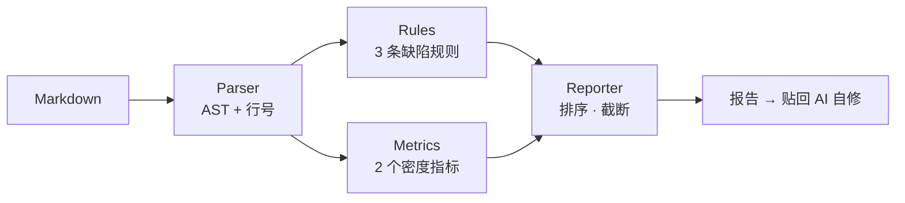

# 文档审计工具 · 技术路线图（精简版）

> 目标：检测 AI 生成文档中的**结构化元素滥用**（表格、列表）。
> 定位：**linter，不是统计器**。统计是输入，输出必须是"哪里错了、改成什么"。

---

## 零、前置：先验证，再写码

**在写任何代码之前，先做半小时人肉验证。**

拿 10 篇文档 —— 5 篇你自己写的、5 篇 AI 生成的 ——
人肉数一下「三段式列表项占比」（`**要点**：说明` 这种结构占列表项的比例）。

- 两组**有明显分离**（如自写 20%、AI 70%）→ 规则成立，往下做
- **没有分离** → 核心直觉是错的，写代码也白写

> 这一步能提前证伪整个工具的地基。成本半小时，收益是避免写一个基于错误假设的工具。

---

## 一、设计原则

**只保留能闭环的东西。** 每条规则、每个指标，都必须能回答同一个问题：
*它能不能让 AI 知道改哪里、改成什么？*

答不上来的，一律砍掉。

由此得出三条取舍线：

- **能定位的留，只能统计的砍**
- **有替代动作的留，只描述现象的砍**
- **能被更简单规则覆盖的砍**

---

## 二、砍掉了什么，为什么

| 砍掉 | 原因 |
| --- | --- |
| 每千字表格数 / 列表数 / 相邻同质率 | 与"结构块占比"高度相关，同一信号的三种说法 |
| 微型表格 | 并入"单列表格"规则 |
| 单例列表、平行重复、重复表格 | 罕见，检测成本高而收益低 |
| `auto` 自动推断 Profile | 黑盒，不可调试。手动 `--profile` 一行参数的事 |
| docx / HTML 多格式支持 | Markdown 没跑通就规划扩展，是幻觉需求 |
| 自动修复 | 改写需要判断，属于 AI 的活，工具只提示 |
| 六个阶段 | v0.3 / v0.5 / v1.0 都是"以后再说" |

**核心反思**：我此前把"观测"当成了"产品"——
设计了一堆指标，但没有一个能直接驱动改稿动作。

---

## 三、MVP 范围

**3 条规则 + 2 个指标 + 1 种输出。**

### 3.1 缺陷规则（主力，必须能定位）

| 规则 | 判定 | 替代动作 |
| --- | --- | --- |
| **三段式列表项** | 列表项匹配 `**加粗**：说明` 模式，占比 > 70% | 整段重写为散文 |
| **退化表格** | 列数 = 1，或单元格均字数 > 40 | 转列表 / 拆成段落 |
| **超长列表项** | 单项 > 100 字 | 拆成段落 |

> **三段式是最强信号**：`**要点**：解释` 是 AI 生成列表最稳定的指纹，
> 人类写作很少这样排。它的密度一旦过半，基本可判定整段需要重写。

### 3.2 密度指标（兜底，只用于整体判断）

| 指标 | 计算 | 初始值 |
| --- | --- | --- |
| 结构块占比 | (表格+列表字数) / 总字数 | 待标定 |
| **无散文率** | 无过渡段落的连续结构块 / 总结构块 | 待标定 |

> 密度层只回答一个问题：**没有明显缺陷，但整体读起来像不像 AI。**
> 它不单独触发修改，只在缺陷规则没命中时兜底提示。

### 3.3 输出（闭环的关键）

```markdown
## 文档审计 · 3 处待改

**L42-58** 退化表格：3 行 × 1 列 → 转列表
**L87** 列表项平均 180 字 → 拆成段落
**L120-190** 三段式列表项占比 82% → 重写为散文
```

三要素缺一不可：**行号 + 问题 + 替代动作**。
**缺任何一个，报告就退化成数字，AI 拿到依然不会改** —— 整个工具报废。

---

## 四、架构



| 模块 | 职责 | 约束 |
| --- | --- | --- |
| Parser | 解析成 AST，**保留行号** | 行号不准则全盘失效 |
| Rules | 逐块检测，输出位置+替代动作 | 只提示，不改写一个字 |
| Metrics | 密度兜底 | 不单独触发修改 |
| Reporter | 按严重度排序，只报 top N | 避免淹没 |

**技术选型**：Python + `markdown-it-py`（支持 GFM 表格、token 流保留行号）+ `click`。
约 150 行，一个下午。

> Parser 留个抽象口子即可，**不要为未来格式提前设计**。

---

## 五、实施路线（两阶段）

### 阶段一：验证（半天）

1. 收集 10 篇语料（自写 5 + AI 生成 5）
2. 人肉统计三段式列表项占比，看两组是否分离
3. **产出**：一个判断——做，还是不做

> 没有分离就到此为止。这是本路线图最重要的一道关卡。

### 阶段二：MVP（一到两天）

1. Parser：Markdown → AST，行号校验
2. 3 条规则 + 2 个指标
3. Markdown 报告输出
4. **验收**：拿真实文档跑，报告贴回 AI，它能按位置改完，复跑达标

---

## 六、阈值标定（阶段二之后）

跑 30 篇（自写 / AI 各 15），看密度指标分布，用分位数反推阈值，
替换掉所有"待标定"。

**在那之前，工具的价值是观测，不是判定。**
我此前凭空给的数字都不算数。

---

## 七、风险与对策

| 风险 | 对策 |
| --- | --- |
| 核心直觉错误 | 阶段一的半小时验证，先证伪再投入 |
| 误报导致工具被弃用 | 只报 top N，规则可逐条关闭 |
| 阈值拍脑袋 | 阶段二之后用语料标定，之前只做观测 |
| 规则越加越多 | 每条新规则必须自带替代动作，否则不纳入 |

---

## 八、与现有工作流咬合

```
AI 成稿 → 落 context 仓库 → audit 跑一遍 → 报告贴回 AI 自修 → 进成品仓库
```

这是《创始人章程》「AI 后置」条款的一个具体执行器：
**AI 负责生成，审计负责判定，人只做确认。**

批量场景下可并入归位提案流程——一次跑完一批，报告合并输出。

---

## 九、一句话

**不为未来设计，不为观测装饰。
只做一件事：告诉 AI 改哪一行、改成什么。**
